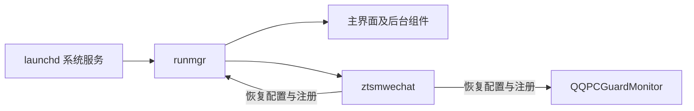

# iOA 卸载工具 · macOS

[](https://github.com/xwhzz/ioa-uninstaller/actions/workflows/tests.yml)
[](LICENSE)

整理一次腾讯 iOA macOS 客户端卸载实践：先处理会互相拉起的后台组件，再注销启动服务，最后删除明确属于该安装的程序、恢复备份与配置。

提供默认只检查的 Python 工具、卸载顺序说明和隔离测试。独立社区项目，与腾讯无隶属关系。

## 验证范围

| 项目 | 当前证据与限制 |
| --- | --- |
| 系统 | 原始卸载实践发生在 Apple Silicon、macOS 26.2 |
| 客户端 | 原始安装包 `211.5.16222.62001`；实际卸载时已自动升级到 `211.6` |
| 标识 | 安装收据 `com.tencent.iOA`；主应用 `com.tencent.QQPCMgr` |
| 安装路径 | 实际验证 `/Applications/QQPCMgr.localized`；代码也识别 `/Library/QQPCMgr.localized`，后者未做真实卸载验证 |
| 环境 | 无 DEP/MDM 注册；未注册 iOA 系统扩展；未检测到需要恢复的 iOA 登录机制和隔离配置 |
| 此仓库版本 | 根据成功的单机脚本重新整理，已做隔离测试；**尚未在第二台安装了 iOA 的机器上端到端验证** |

自动执行目前只接受 `211.5.*` / `211.6.*` 版本家族。这是保守的识别范围，并不表示每个构建都经过验证。未知版本、签名异常、托管设备、iOA 系统扩展、登录机制或隔离配置会阻止自动卸载。

本工具用于你拥有卸载权限的 Mac。它会断开 **iOA 自己的网络通道**，永久删除报告中列出的 iOA 数据和安装备份；请先保存工作并检查清单。

## 使用

需要 Python 3.9 或以上，仅使用标准库。先检查 `python3 --version`；系统未提供 Python 时，需要先准备 Python 运行环境。

下载并阅读代码：

```sh
git clone https://github.com/xwhzz/ioa-uninstaller.git
cd ioa-uninstaller
python3 uninstall_ioa.py --help
```

默认仅检查。为读取系统启动配置和 root 账户残留，完整检查需要管理员权限：

```sh
sudo /usr/bin/python3 -I uninstall_ioa.py --dry-run
```

如果使用其他 Python，请将 `/usr/bin/python3` 换成可信 Python 解释器的绝对路径。不要通过 `curl | sudo sh` 运行。

检查终端列出的删除路径及报告，确认全部属于要移除的 iOA 安装，再执行：

```sh
sudo /usr/bin/python3 -I uninstall_ioa.py --apply
```

`--apply` 会重新检查当前状态，不读取、信任上一次报告中的路径。账户从 `SUDO_UID` 自动识别，不写死用户名或 UID。直接从 root 会话运行时，必须用 `--user 本地账户名` 指定用户。其他安装位置可明确指定：

```sh
sudo /usr/bin/python3 -I uninstall_ioa.py --dry-run --app-root /Library/QQPCMgr.localized
```

若只剩残留、主应用已不存在，当前版本只报告，不自动删除，避免把缺少身份依据的目录认作完整安装。

## 为什么需要这个顺序

普通退出和卸载入口会读取 `ExitTrayPolicy` / `UninstallPolicy`。腾讯的[客户端自保护说明](https://cloud.tencent.com/document/product/1092/128262)介绍了企业侧的退出、卸载及自保护策略。

在本次检查的客户端中，还存在以下本地机制：

1. `runmgr` 拉起主界面与其他后台组件。
2. `ztsmwechat` 检查 `runmgr` 和 `QQPCGuardMonitor` 的启动配置及注册状态，必要时恢复配置并重新加载服务。
3. 核心程序文件缺失时，安装包保护模块具备利用匹配的本地备份重新安装的能力。该能力由静态代码检查确认；本次实践没有直接证明这一重装分支实际触发。



因此，单独结束主程序，或只删除一个启动项，可能被仍运行的组件恢复。完整说明见 [docs/method.md](docs/method.md)。

## 工具执行的步骤

1. 验证应用 bundle ID、版本和腾讯签名；检查不支持自动处理的系统配置。
2. 列出明确归属 iOA 的启动项、程序、备份、当前用户与 root 账户的已知数据。按完整路径筛选进程及其子进程。
3. 暂停 iOA 自己的重启监督组件，调用已验证签名的内置工具停止 iOA VPN。
4. 注销已识别的 launchd 服务，等待异步退出，再结束残余进程。
5. 再次验证路径身份，删除已列出的目标并忘记安装收据。
6. 检查目标、进程、服务和收据是否仍存在，记录卸载前后的 DNS / 代理快照。

不会修改 SIP、全局 DNS、系统代理或其他 VPN 的配置；不会批量删除 `com.tencent.*`、QQ 或微信目录。停止 iOA VPN 本身仍可能改变系统动态网络状态，因此不能把“脚本没有设置 DNS”理解成“网络一定不变”。

工具拒绝目标或祖先路径中的符号链接、挂载目录及检查后被替换的目标。内部符号链接只会被解除链接，不会递归删除其指向的数据。信号发送前重新核对进程路径与启动时间，避免仅凭同名进程或旧 PID 操作。

## 报告与完成条件

每次运行在 `/private/var/tmp/ioa-uninstaller-随机后缀/result.json` 写入本地报告，目录权限为 `0700`。通过 `sudo` 运行生成的报告需要管理员权限读取。

| 状态 | 含义 |
| --- | --- |
| `inspection_ready` | 该次检查未发现阻止条件，尚未卸载 |
| `inspection_blocked` | 存在权限不足、未知环境或缺少主应用等情况；不会执行自动卸载 |
| `complete_for_listed_targets` | 本次列出的文件、已识别进程/服务与收据均已通过移除后检查 |
| `failed` | 执行或验证失败，查看错误及已经完成的步骤 |

退出码：`0` 表示当前操作成功，`2` 表示检查存在阻止条件，`1` 表示执行失败。

完成状态**不代表扫描过整台磁盘**。其他用户账户、个人下载目录、废纸篓、未知插件、证书和描述文件不在自动清理范围内。本项目也不捆绑某台机器特有的 DNS 修复措施。

失败时，会尽力恢复本工具暂停且仍然存在的进程；已经注销的服务和已经删除的文件不会自动回滚。停止阶段失败时不会开始删除应用文件。请保留报告，不要通过删除检查条件来强行继续。

报告可能含本地用户名、文件路径和网络配置。提交问题时只摘录并脱敏相关错误，不要直接上传整份报告、安装包、企业策略、下载地址签名参数或认证信息。

## 开发与贡献

```sh
python3 -m py_compile uninstall_ioa.py
python3 -m unittest discover -s tests -v
```

测试使用临时目录和模拟的系统接口，不安装 iOA、不停止真实进程、不改动真实网络设置。CI 只运行这些测试与 CLI 帮助。

欢迎提交经过脱敏的版本兼容性结果。请区分“只读检查通过”“隔离测试通过”和“在授权设备上完整卸载并复查通过”。新增删除目标必须说明归属依据，并覆盖符号链接、路径边界和错误处理测试。

代码与原创文档使用 [MIT License](LICENSE)。本仓库不分发腾讯安装包、二进制、厂商脚本或原始个人取证记录。
